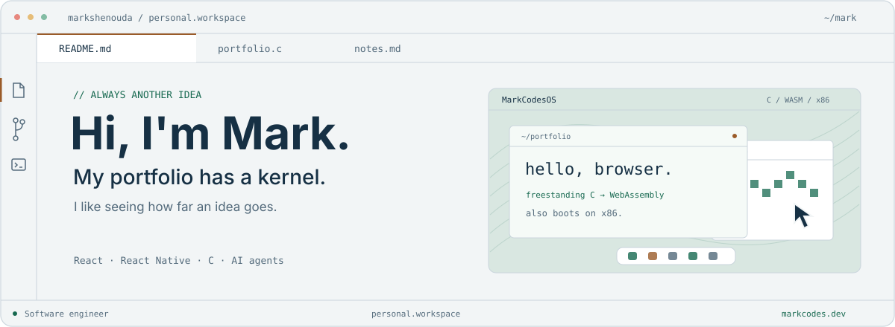

<!-- Reading the source? Hi. The window manager is over in MarkCodesOS. -->
<picture>
  <source media="(max-width: 600px) and (prefers-color-scheme: dark)" srcset="assets/workspace-mobile-dark.svg">
  <source media="(max-width: 600px) and (prefers-color-scheme: light)" srcset="assets/workspace-mobile-light.svg">
  <source media="(prefers-color-scheme: dark)" srcset="assets/workspace-dark.svg">
  <source media="(prefers-color-scheme: light)" srcset="assets/workspace-light.svg">
  
</picture>

[portfolio/](https://markcodes.dev) · [notes.md](https://markcodes.dev/posts) · [talks/](https://markcodes.dev/videos) · [LinkedIn](https://www.linkedin.com/in/marksshenouda/) · [say hello](https://markcodes.dev/contact)

# Hi, I'm Mark.

I'm a software engineer in Cairo, Egypt. I studied accounting at Mansoura University, then built a career writing software.

I mostly work with React, TypeScript, Next.js, and React Native. My work at This Dot Labs has included mobile apps with AR-assisted workflows and Shopify storefronts.

My portfolio has been a tiny operating system and a VS Code workspace. I like following an idea far enough to understand what makes it work.

## A few open tabs

### [MarkCodesOS](https://github.com/markshenouda/MarkCodesOS) / my portfolio has a kernel

A desktop written in freestanding C, drawn one pixel at a time. Windows, a dock, a terminal, even a few games. The same core runs in a browser through WebAssembly and boots on bare-metal x86.

[Boot it in your browser](https://os.markcodes.dev) · `C` `WebAssembly` `x86`

### [VibeRN](https://github.com/markshenouda/VibeRN) / fewer setup chores

The Expo starter I reach for when I want to get to the app itself. A design system, forms, typed navigation, and light/dark themes, already wired together.

### [OpenCode Blender Mode](https://github.com/markshenouda/opencode-blender) / an agent in the scene

An OpenCode mode that connects an agent to Blender through MCP. Describe a scene, change the materials, adjust the lighting, all through conversation.

### [Macintosh 1984 Simulator](https://github.com/markshenouda/macintosh-simulator) / another desktop in a browser

A simulator of the original Macintosh, built with React, Three.js, and PCE. Apparently one desktop wasn't enough.

## notes.md

Sometimes the experiment turns into a post.

- [Decompiling a real program with AI agents](https://markcodes.dev/posts/ai-agents-decompile-binaries). A stripped basE91 binary, recovered C, and the evidence.
- [WebGPU experiments](https://markcodes.dev/posts/vgpu-experiments). Particles, fractals, and shaders you can edit as you read.
- [Build a React custom renderer](https://markcodes.dev/posts/build-react-custom-renderer-part-1). A look at React beyond the DOM.

I also [write for This Dot Labs](https://markcodes.dev/posts) and [teach in live coding sessions](https://markcodes.dev/videos).

A little more about my work

I've contributed to Wikimedia and Chainlink projects, and helped build and maintain starter.dev templates across frontend frameworks. Earlier, I freelanced on full-stack apps with React, Laravel, and PostgreSQL.

React and TypeScript are familiar territory. C, Swift, WebAssembly, and GPU programming keep giving me new things to learn.

[More about me](https://markcodes.dev/about) · [Resume](https://markcodes.dev/resume)

---

If you've also let a small idea turn into a whole project, we'd probably have something to talk about. [Say hello](https://markcodes.dev/contact).
